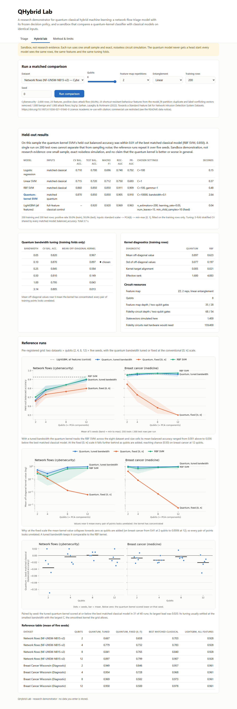
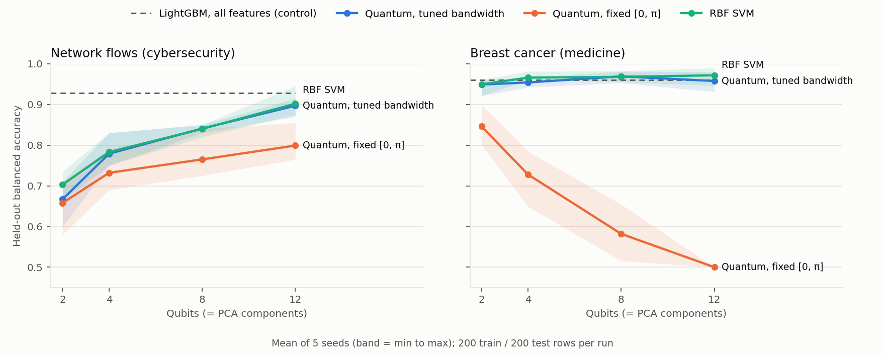
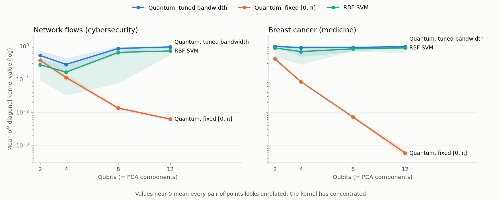

# QHybrid Lab

A containerised web service that puts a quantum-kernel classifier next to classical models on
identical inputs, and serves a calibrated network-intrusion triage model, so that the comparison
can be checked rather than taken on trust. It comes from a classical-first research programme on
where, if anywhere, quantum machine learning helps cybersecurity classification. The quantum part
is a labelled sandbox: no result here is presented as quantum advantage.



## What it does

- **Network-flow triage.** Scores NetFlow v2 flows with a frozen LightGBM model (29 behaviour
  features), a Platt calibration map and three decision policies fixed on separate partitions.
  It returns a calibrated risk and an alert decision, and refuses to start if any shipped file
  differs from its recorded SHA-256 hash.
- **Hybrid lab (sandbox).** For a chosen dataset, qubit count, feature-map depth and seed, it
  trains logistic regression, a linear SVM, an RBF SVM and a quantum-kernel SVM on the same rows,
  the same features and the same tuning folds, and reports held-out metrics, kernel diagnostics
  and the circuits real quantum hardware would need. A LightGBM model on all original features of
  the same rows is shown as a classical control. Datasets: network flows (cybersecurity) and
  Breast Cancer Wisconsin (medicine).

## Results

### Triage model

On the 478,055-flow validation partition of NF-UNSW-NB15-v2, the service reproduces the research
model's strict-policy confusion matrix exactly (458,593 true negatives, 452 false positives,
1,776 false negatives, 17,234 true positives):

| Measure | Value |
|---|---|
| PR-AUC | 0.991 |
| Attack recall at the strict policy (validation false-positive rate ≤ 0.1%) | 0.907 |
| False alerts per 100,000 benign flows at the strict policy | 98.5 |
| Macro F1 at the balanced policy | 0.981 |

Known limits, quoted in the model card: validation is on the same corpus only, and TTL-type
features alone reach macro F1 0.954 (removing them costs 0.0016 macro F1). The model is not
approved for operational deployment.

### Hybrid lab reference grid

A grid fixed before it was run: 2 datasets × qubits {2, 4, 8, 12} × 5 seeds × 2 bandwidth
settings = 80 runs, each with 200 training and 200 test rows.



- **Without bandwidth tuning** (inputs scaled to [0, π]), quantum kernel values concentrate as
  qubits are added. On breast cancer the mean off-diagonal kernel value falls from 0.41 at 2
  qubits to 0.0006 at 12, and balanced accuracy falls from 0.846 to 0.500 (chance).
- **With the bandwidth tuned** like an RBF kernel's gamma, the quantum kernel tracks the RBF SVM.
  Across the eight dataset-and-size cells its mean balanced accuracy ranged from 0.001 above to
  0.036 below the best matched classical model. Paired by seed, it scored at or below that model
  in 31 of 40 runs; its largest lead was 0.020.
- The all-features LightGBM control reached 0.928 (network flows) and 0.961 (breast cancer) on the
  same 200 training rows.



## Method

1. One stratified sample per run. Standard scaling, then PCA to one component per qubit, then
   rescaling to [0, 1], all fitted on the training rows only.
2. Every matched model is tuned on the same five stratified folds with balanced accuracy, then
   scored once on the test rows.
3. The quantum kernel is K(x, y) = |⟨ψ(bx)|ψ(by)⟩|² for a ZZ feature map, computed from exact
   statevectors (positive semidefinite by construction). The bandwidth b is chosen from
   {0.05, 0.1, 0.25, 0.5, 1, π} by the same cross-validation, smaller b winning ties.
4. **Tuning-grid amendment.** In the first run of the grid, the selected C sat on the top edge of
   {0.1, 1, 10, 100} in 32 of 40 quantum runs (20–25 for the classical models), so the grid was
   too narrow and constrained the quantum model most. Before re-running, the C grid was widened to
   {0.1, …, 10⁴} and the RBF gamma grid to {0.01, …, 100} for every model. The mean paired gap
   moved from −0.022 to −0.012; the results above are from the amended run. In the amended run the
   quantum optimum sits at the smallest bandwidth and largest C, where b and C trade off along a
   ridge (to leading order K ≈ 1 − b²·g(x, y)), so the grid was not widened again.

Background on bandwidth and concentration: Shaydulin & Wild, arXiv:2111.05451; Canatar et al.,
arXiv:2206.06686; Thanasilp, Wang, Cerezo & Holmes, doi:10.1038/s41467-024-49287-w.

## Run it

With Docker:

```bash
docker compose up --build lab
```

Open <http://127.0.0.1:8765>. The API is documented at <http://127.0.0.1:8765/docs>. More detail,
including the endpoints and request limits, is in
[`deployment/lab/README.md`](deployment/lab/README.md).

## Test

```bash
docker compose run --rm test
```

Without Docker (Python 3.11):

```bash
pip install --require-hashes --no-deps -r requirements/lab.lock
pip install --require-hashes --no-deps -r requirements/lab-test.lock
PYTHONPATH=src python -m pytest tests
```

## Layout

| Path | Contents |
|---|---|
| `src/qhcyber/serving/` | Triage scoring and the asset manifest check |
| `src/qhcyber/quantum/` | Bandwidth-scaled fidelity kernel, diagnostics and circuit resources |
| `src/qhcyber/lab/` | Dataset registry and the matched benchmark |
| `deployment/lab/` | FastAPI app, web interface, Dockerfile and the asset bundle |
| `scripts/` | Re-runs the reference grid and redraws its figures |
| `tests/` | Unit, parity and HTTP tests |

## How the assets were built

`deployment/lab/assets/` holds the frozen triage model and policy, 20 example flows with their
expected risk, a 2,000-row lab sample, the reference grid and its figures. Each file's SHA-256 is in
`MANIFEST.json`. The model, examples and sample were exported from a private research pipeline
(the full dataset is not redistributed). The 2,000-row sample keeps the 25 shortcut-resistant flow
features, draws only from the training partition, removes duplicate and label-conflicting feature
vectors, and is balanced 1,000 benign to 1,000 attack. The reference grid can be re-run from this
repository with `python scripts/build_lab_reference_runs.py` (needs matplotlib 3.10.8 for the
figures).

## Data and model notice

The code is licensed under Apache-2.0 (`LICENSE`). That licence covers code only.

- **NF-UNSW-NB15-v2** (the triage model, its example flows and the lab's network-flow sample are
  derived from it): University of Queensland, permitted re-use with commercial use restriction.
  Academic use requires this citation; commercial use requires the authors' agreement. The shipped
  sample and model are for non-commercial research and education only. Mohanad Sarhan, Siamak
  Layeghy and Marius Portmann, "Towards a Standard Feature Set for Network Intrusion Detection
  System Datasets", *Mobile Networks and Applications* (2022),
  <https://doi.org/10.1007/s11036-021-01843-0>.
- **Breast Cancer Wisconsin (Diagnostic)**, loaded from the copy bundled with scikit-learn:
  CC BY 4.0. Wolberg, W., Mangasarian, O., Street, N. & Street, W. (1993), UCI Machine Learning
  Repository, <https://doi.org/10.24432/C5DW2B>.
